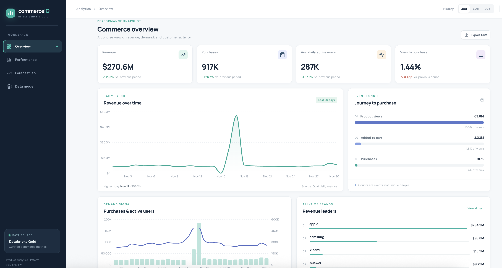
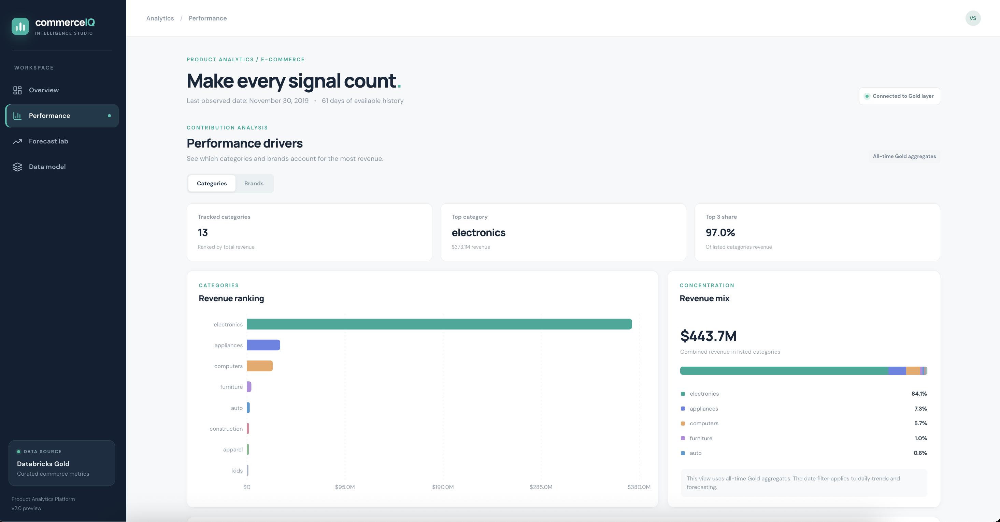
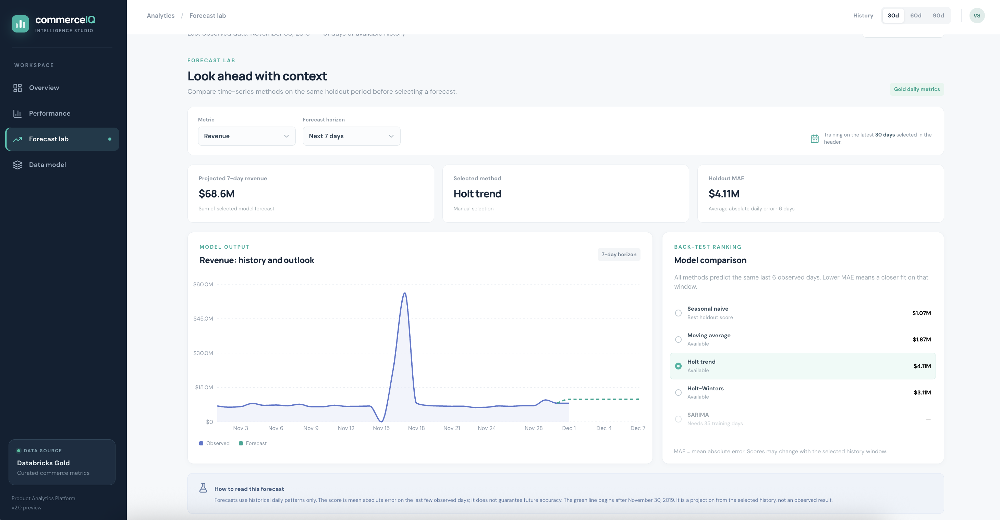

# Product Analytics Platform

A lakehouse project covering event ingestion, dimensional modeling, Gold aggregates, and an interactive analytics dashboard.

**Built with:** Databricks Delta Lake + Kafka Streaming + FastAPI + React/TypeScript

**Architecture:** Medallion (Bronze → Silver → Gold) + Real-time Processing + Interactive Analytics

## Dashboard

The React dashboard reads the Databricks Gold layer through a read-only Python API. It brings together daily commerce metrics, category and brand performance, and a forecasting lab that compares five time-series methods on the same holdout window.



**Overview:** Revenue, purchases, active users, conversion, daily trends, and the event funnel.

### Performance

Category and brand revenue concentration from Gold aggregates.



### Forecast Lab

Historical trend, projected values, and holdout MAE across forecasting methods.



See [dashboard/README.md](dashboard/README.md) for local setup, data definitions, and deployment notes.

For public access, the [hosting plan](dashboard/DEPLOYMENT.md) recommends a static site on Vercel or Cloudflare Pages built from a real Gold data snapshot. The local dashboard currently uses a live Databricks connection; public hosting has not been configured yet.

---

## What's Built

### Complete Lakehouse Platform

**1. Hybrid Ingestion Pipeline (Batch + Streaming)**
- Bronze layer: Unified table for both batch and streaming ingestion
- Batch: 109.9M events loaded from Kaggle CSV (source='batch')
- Streaming: Kafka setup ready (Confluent Cloud integration)
- Unified Processing: Both sources flow through the same medallion transformation path

**2. Medallion Architecture (Bronze → Silver → Gold)**
- **Bronze**: Raw append-only event storage
- **Silver**: Star schema with 4 dimensions (date, products, users, categories) + fact table
  - SCD Type 2 for products and users (price/behavior tracking)
  - Surrogate keys for dimensional integrity
- **Gold**: Pre-aggregated business metrics
  - Daily metrics (DAU, conversion rates, revenue)
  - Product performance (top sellers, revenue by brand)
  - Category performance (sales by category)

**3. Interactive Analytics Dashboard (React + FastAPI)**
- Overview: KPIs, conversion funnel, daily trends
- Performance: Category and brand revenue rankings and concentration
- Forecast Lab: Five time-series methods, holdout MAE, and configurable history and horizon
- Read-only API over the Databricks Gold layer

**4. Data Source**
- eCommerce behavior dataset (REES46 via Kaggle)
- 109.9M events | 5.3M users | 206K products | 426 days
- Event types: view, cart, purchase

### Silver Layer Schema

**Star Schema Architecture:**
```
         dim_date (426 rows)
              │
              ├─────────────┐
              │             │
     dim_categories    fact_events    dim_products
       (130 rows)    (109.9M rows)   (206.9K rows, SCD2)
              │             │
              └─────────────┘
                    │
              dim_users
           (5.3M rows, SCD2)
```

**Fact Table:** `fact_events`
- 109.9M rows (one row per event)
- Grain: individual user event (view, cart, purchase)
- FKs to all 4 dimensions via surrogate keys
- Measures: revenue, quantity, event_count

**Dimensions:**
1. **dim_date** - Date dimension (426 days)
2. **dim_categories** - Product category hierarchy (3 levels)
3. **dim_products** - Product master with price/brand (SCD Type 2)
4. **dim_users** - User profiles with behavioral segments (SCD Type 2)

**SCD Type 2:**
- Products track price/brand changes over time
- Users track behavioral evolution (casual → engaged → power_user)
- Point-in-time accuracy: fact table joins to correct version at event_time
- History preserved: effective_from/effective_to dates, version_number

---

## Key Technical Decisions

**Star Schema over Snowflake**
- Fewer joins, better query performance
- BI-friendly, simpler for analysts
- Delta Lake compression handles denormalization

**SCD Type 2 for Products/Users**
- Track price changes over time
- Track user behavioral evolution
- Point-in-time accurate historical analysis

**Surrogate Keys**
- Natural keys can change
- SCD Type 2 requires unique keys per version
- Integer surrogates enable efficient joins

**Delta Lake Foundation**
- ACID transactions
- Time Travel for auditing
- OPTIMIZE/Z-ORDER for performance
- Auto-Optimize for automatic maintenance
- MERGE support for SCD Type 2 updates

---

## Sample Queries

**Monthly Revenue by Brand:**
```sql
SELECT 
    d.year, d.month_name, p.brand,
    SUM(f.revenue) as total_revenue,
    COUNT(*) as purchases
FROM product_analytics.ecommerce.fact_events f
JOIN product_analytics.ecommerce.silver_dim_date d 
    ON f.date_sk = d.date_key
JOIN product_analytics.ecommerce.silver_dim_products p 
    ON f.product_sk = p.product_sk
WHERE f.event_type = 'purchase' AND d.year = 2019
GROUP BY d.year, d.month_name, d.month, p.brand
ORDER BY d.month, total_revenue DESC;
```

**User Segment Performance:**
```sql
SELECT 
    u.user_segment,
    COUNT(DISTINCT f.user_sk) as unique_users,
    SUM(CASE WHEN f.event_type = 'purchase' THEN 1 ELSE 0 END) as purchases,
    ROUND(SUM(f.revenue), 2) as total_revenue
FROM product_analytics.ecommerce.fact_events f
JOIN product_analytics.ecommerce.silver_dim_users u 
    ON f.user_sk = u.user_sk
GROUP BY u.user_segment
ORDER BY total_revenue DESC;
```

**Category Performance by Day:**
```sql
SELECT 
    d.day_name, c.category_l1,
    COUNT(*) as events,
    SUM(CASE WHEN f.event_type = 'purchase' THEN 1 ELSE 0 END) as purchases,
    ROUND(SUM(f.revenue), 2) as revenue
FROM product_analytics.ecommerce.fact_events f
JOIN product_analytics.ecommerce.silver_dim_date d 
    ON f.date_sk = d.date_key
JOIN product_analytics.ecommerce.silver_dim_categories c 
    ON f.category_sk = c.category_sk
WHERE f.event_type = 'purchase'
GROUP BY d.day_name, c.category_l1
ORDER BY revenue DESC;
```

---

## Project Structure

```
product-analytics-platform/
│
├── config/
│   ├── platform_config.py          # Databricks workspace configuration
│   └── logging_config.py           # Production logging setup
│
├── bronze/
│   ├── kaggle_ingestion.py         # Initial Kaggle dataset load
│   └── bronze_layer_build.py       # Bronze Delta table creation
│
├── silver/
│   ├── silver_dimensions_build.py  # Star schema dimensions
│   └── silver_fact_build.py        # Fact table with SCD Type 2
│
├── gold/
│   ├── gold_daily_metrics.py       # DAU, conversion, revenue aggregates
│   ├── gold_product_performance.py # Product/brand analytics
│   └── gold_category_performance.py # Category metrics
│
├── streaming/
│   ├── kafka_event_producer.py     # Event producer (writes to staging table)
│   └── kafka_event_consumer.py     # Consumer (writes to unified bronze_events)
│
├── dashboard/
│   ├── backend/                    # FastAPI, Gold queries, and forecasting
│   └── web/                        # React/TypeScript dashboard
│
├── docs/
│   ├── assets/dashboard/           # Dashboard screenshots for this README
│   ├── SILVER_LAYER_ARCHITECTURE.md
│   └── DIMENSIONS_COMPLETE_GUIDE.md
│
└── README.md
```

---

## Delta Lake Features

All tables use Delta Lake with:
- **OPTIMIZE**: File compaction for query performance
- **Z-ORDER**: Data clustering (fact_events on event_date, product_sk)
- **Auto-Optimize**: Automatic optimizeWrite + autoCompact
- **Time Travel**: Version history tracking
- **Compression**: zstd compression
- **Deletion Vectors**: Efficient deletes/updates
- **MERGE**: Transactional SCD Type 2 updates

---

## User Segmentation

Users are classified based on behavior:

- **power_user**: ≥100 events OR ≥10 purchases OR avg ≥10 events/day
- **engaged**: ≥20 events OR ≥2 purchases OR avg ≥2 events/day  
- **casual**: Everyone else

---

## What's Next

**Advanced Analytics & ML:**
- Extend forecasting with longer history, external drivers, and calibrated intervals
- Customer lifetime value prediction (MLflow + Feature Store)
- Churn prediction with real-time scoring
- Product recommendation engine (collaborative filtering)

**Infrastructure:**
- CI/CD pipeline (GitHub Actions)
- Data quality monitoring
- Automated testing suite
- Cost optimization (cluster autoscaling)

---

## Technologies

**Data Platform:**
- **Lakehouse**: Databricks Workspace (cloud-hosted)
- **Storage**: Delta Lake with Unity Catalog
- **Compute**: Apache Spark (Serverless)
- **Streaming**: Kafka (Confluent Cloud) + Spark Structured Streaming

**Development:**
- **Languages**: Python, SQL, TypeScript
- **Dashboard**: React + FastAPI
- **Version Control**: Git + GitHub
- **Logging**: Centralized Python logging configuration

**Architecture:**
- **Pattern**: Medallion Architecture (Bronze/Silver/Gold) with hybrid ingestion
- **Data Modeling**: Kimball star schema with SCD Type 2
- **Processing**: Unified transformation path for both batch and streaming sources
- **Processing**: Batch and streaming events use the same Bronze-to-Gold transformation path

**Note:** Databricks workspace runs on cloud infrastructure (AWS backend in this case), but the platform abstracts infrastructure management - no direct AWS provisioning required.

---

## Dataset

**Source**: eCommerce Behavior Data from Multi-Category Store (REES46)

**Event Types**:
- `view` - Product page view
- `cart` - Add to cart
- `remove_from_cart` - Remove from cart
- `purchase` - Purchase completed

**Original Fields**:
- event_time, event_type, product_id, category_id, category_code
- brand, price, user_id, user_session

**Period**: 426 days of e-commerce activity  
**Volume**: 109.9M events across 5.3M users and 206K products

---

## Production Features

This platform demonstrates end-to-end data engineering best practices:

**Data Modeling:**
- Kimball dimensional modeling (star schema)
- SCD Type 2 for historical tracking (products, users)
- Surrogate key management for data integrity
- Proper fact/dimension separation

**Lakehouse Architecture:**
- ACID transactions with Delta Lake
- Time travel for data versioning
- OPTIMIZE + Z-ORDER for query performance
- Lambda Architecture: Unified bronze layer (batch + streaming)
- Bronze contains raw natural keys only (product_id, user_id, category_id)
- Enrichment with surrogate keys happens in Silver layer

**Code Quality:**
- Centralized logging configuration
- Error handling and data validation
- Modular code structure (separation of concerns)
- Git version control

**Deployment:**
- Local React/FastAPI dashboard connected to the Databricks Gold layer
- Streaming infrastructure ready (Kafka integration setup)
- Scalable compute (Spark Serverless)

---

## Key Achievements

**Scale:** 109.9M events | 5.3M users | 206K products | 426 days

**Architecture:** Complete medallion lakehouse (Bronze → Silver → Gold)

**Hybrid Ingestion:** Unified pipeline supporting both batch CSV and streaming Kafka sources

**Production-Ready:** Deployed dashboard with proper logging, error handling, and data quality checks

---

Built to showcase comprehensive data engineering skills: from raw event ingestion through dimensional modeling to production analytics deployment.
